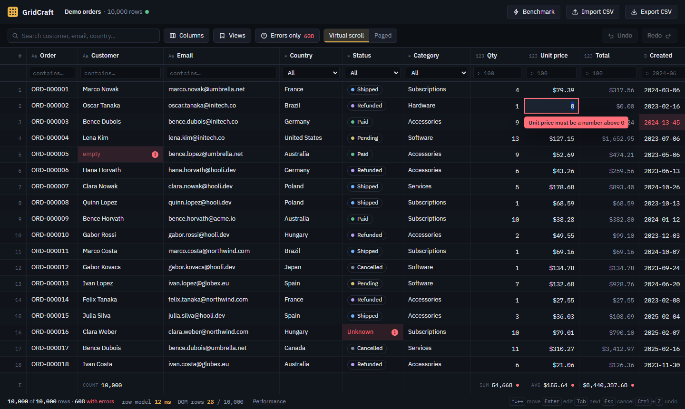
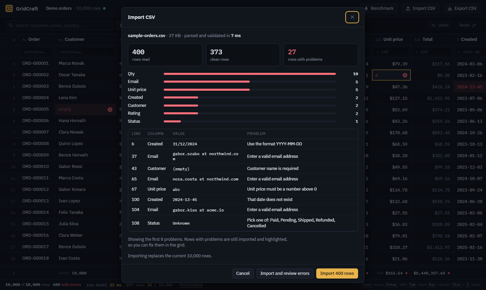
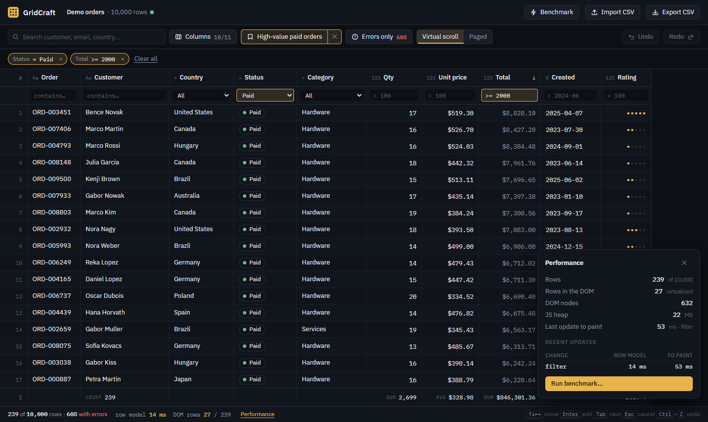

# GridCraft

[](https://github.com/IraMilcsevics/grid-craft/actions/workflows/ci.yml)

**[Live demo](https://iramilcsevics.github.io/grid-craft/)** · React, TypeScript, TanStack Table v9 and TanStack Virtual · runs entirely in the browser

An advanced data grid built around three problems that real data tools run into: **a lot of rows**, **data that is wrong**, and
**state that has to survive** (filters, sorting, columns, your edits). The demo is an order list of 10,000 rows in which about 6% of
the rows are deliberately broken, so validation, error review and CSV import always have something to work on.



<table>
  <tr>
    <td width="50%"><br><sub>CSV import with a validation report. Parsing runs in a Web Worker.</sub></td>
    <td width="50%"><br><sub>Saved views, filter chips and the live performance panel.</sub></td>
  </tr>
</table>

The clickable design reference is [prototype/gridcraft-prototype.html](prototype/gridcraft-prototype.html).

## What it does

- **Big data:** virtualized rows (about 24 rows in the DOM whatever the dataset size), or paged mode. Tested up to 100,000 rows.
- **Search and filters:** global search, per-column filters with operators (`> 100`, `>= 2000`, `> 2024-06`), enum dropdowns, an "errors only" switch and removable filter chips.
- **Sorting:** click a header to sort, click again to reverse, Shift-click to add a second sort column. Empty and invalid values always sort last.
- **Inline editing:** Enter, F2, double-click or just start typing. Values are validated while typing, an invalid value cannot be committed, Tab and Enter move to the next cell, Ctrl+Z / Ctrl+Y undo and redo.
- **Columns:** show and hide, reorder by dragging a header or with the menu, resize by dragging (double-click resets).
- **CSV:** import in a Web Worker with a validation report, export of the current view or of everything.
- **Your data stays:** edits and imported files are saved in the browser (IndexedDB) and are back after a reload. Nothing is uploaded.
- **Views:** save, update, rename and delete views in `localStorage`, plus three built-in ones. The same state is in the URL, so a link restores the screen.
- **Totals row:** count, sum and average, calculated with TanStack's aggregation over all filtered rows. Invalid cells are left out and counted.
- **Performance panel and benchmark:** live timings in the app, and a benchmark you can run from the header button.

## Run it

```bash
npm install
npm run dev          # http://localhost:5173
```

| Command | What it does |
| --- | --- |
| `npm run dev` | Vite dev server |
| `npm test` | Vitest for the data layer (validation, generator, CSV, filters, editing history, views) |
| `npm run typecheck` | `tsc -b`, strict mode |
| `npm run build` / `npm run preview` | Production build and local preview |
| `npm run bench:domain` | Headless benchmark of the data layer in Node |
| `npm run bench:browser` | The in-app benchmark in headless Chrome against the production build (run `npm run build` first) |
| `npm run screenshots` | Retakes the README images from the production build |

Two URL flags are for testing: `?rows=100000` loads a bigger demo dataset (100 to 250,000) and `?virtual=off` draws
every row, to show what virtualization saves. They are kept when the grid updates the address bar.

## Where the data lives

Everything stays in the browser; the app has no server.

| What | Where | How big |
| --- | --- | --- |
| Demo data | Regenerated from a fixed seed on every load | not stored |
| An imported file | IndexedDB (`gridcraft` database), once, as imported | the size of the file (100,000 rows is about 9 MB) |
| Your edits | IndexedDB, as a list of changed cells on top of the dataset | a few bytes per edited cell |
| Saved views | `localStorage` (`gridcraft.views`) | under 1 KB each |
| Current view | The URL | n/a |

An edit saves only the changed cell, about 250 ms after you stop, and again when the tab is hidden or closed, so editing stays fast even on a large file.
**Data menu** (click the dataset name in the header) shows whether the data is saved, and has *Discard all edits* (back to the original values) and *Load demo data*
(drop an imported file). If the browser blocks storage, the app keeps working in memory and says "Not saved". Stored data is validated when it is read back, and anything
unusable is ignored instead of breaking startup. `?rows=` skips storage altogether.

## How the three problems are handled

**Many rows.** Rows are drawn by TanStack Virtual from the final row model, so filtering, sorting and paging happen first and the
browser only ever lays out the rows in view. Filters are compiled once per change into a predicate, not parsed per row. CSV parsing
and validation run in a Web Worker so a large file does not freeze the page. Numbers are in [Performance](#performance).

**Wrong data.** Nothing is dropped. A value that cannot be parsed (`n/a` in a quantity, `31/12/2024` as a date) stays in the row as
typed, the cell is marked, and the message is one hover away. Validation is plain functions in `src/domain/validate.ts`, shared by the
grid, the editor, the importer and the totals row. The importer reports how many rows failed, which columns, and the first problems with
their line numbers; "Import and review errors" opens the result straight in the errors-only view.

**State.** Filters, sorting, column visibility, order, widths, row mode and page size are one `ViewState`
(`src/domain/view.ts`). The same object is what a saved view stores and what the URL encodes, and both are sanitized on the way in, so a
stale, hand-edited or corrupt value falls back to defaults instead of breaking the screen. Saved views are versioned in `localStorage`
and the app still works when the browser blocks storage. Cell edits are deliberately not part of a view.

## Performance

Measured with `npm run bench:browser` on the production build, in headless Chrome on an Intel Core i5-4590 (2014, 4 logical cores,
16 GB RAM). That is a modest machine, and headless Chrome has no GPU, so treat the numbers as conservative. Every operation is applied
through the real table and timed until the browser has painted the result, so React rendering and layout are included. Medians of 6 runs
after a discarded warm-up. Full output is in [bench-results/browser.md](bench-results/browser.md).

| Operation | 1,000 rows | 10,000 rows | 100,000 rows |
| --- | ---: | ---: | ---: |
| Baseline: no change, wait for paint | 29 ms | 30 ms | 29 ms |
| Global search "an" | 29 ms | 41 ms | 294 ms |
| Column filter: Qty > 5 | 29 ms | 37 ms | 185 ms |
| Search + Status + Total filters | 29 ms | 41 ms | 157 ms |
| Errors only | 30 ms | 30 ms | 112 ms |
| Sort by Customer (text) | 34 ms | 86 ms | 693 ms |
| Sort by Total (computed) | 30 ms | 86 ms | 811 ms |
| Sort by Country, then Created | 30 ms | 111 ms | 1,066 ms |
| Edit one cell (data sorted by Total) | 29 ms | 78 ms | 1,182 ms |
| Scroll top to bottom in 2 s | 50 fps | 41 fps | 33 fps |
| Build CSV for every row | 1.2 ms | 13 ms | 115 ms |
| Import CSV (worker, parse and validate) | 21 ms | 83 ms | 767 ms |

The baseline is the cost of waiting for two frames, so subtract about 30 ms from the rows above it. Scrolling at 100,000 rows covers the
whole list in two seconds, so it is a harder test than at 1,000 rows. At 10,000 rows, which is the demo size, a filter adds 7 to 11 ms on top of
the baseline, a single-column sort about 55 ms and a two-column sort about 80 ms.

### What virtualization buys

Same app, same data, `?virtual=off` against the default:

| Rows | Virtualization | Grid painted | DOM nodes | Scroll |
| ---: | --- | ---: | ---: | ---: |
| 1,000 | on | 415 ms | 679 | 50 fps, p95 frame 20 ms |
| 10,000 | on | 369 ms | 679 | 41 fps, p95 frame 40 ms |
| 100,000 | on | 1,195 ms | 679 | 33 fps, p95 frame 40 ms |
| 1,000 | off | 1,072 ms | 16,195 | 21 fps, p95 frame 60 ms |
| 10,000 | off | 9,934 ms | 160,084 | 3 fps, p95 frame 660 ms |

Times are from navigation start, so they include loading the app. With virtualization the DOM stays at 679 nodes at every size. Without
it, 10,000 rows take about 10 seconds to appear and scrolling is unusable. The 100,000-row case without virtualization was not run.

### Data layer on its own

`npm run bench:domain`, Node 22, no browser, median of 7 runs ([bench-results/domain.md](bench-results/domain.md)):

| Operation | 1,000 rows | 10,000 rows | 100,000 rows |
| --- | ---: | ---: | ---: |
| Generate rows | 3.0 ms | 20 ms | 225 ms |
| Validate every cell | 3.1 ms | 31 ms | 298 ms |
| Build CSV | 1.9 ms | 21 ms | 231 ms |
| Parse CSV text | 1.5 ms | 22 ms | 236 ms |
| Parse and import with validation report | 7.1 ms | 69 ms | 692 ms |

### Known limits

- **Editing at 100,000 rows takes about 1.2 s.** An edit creates a new data array and TanStack rebuilds the whole row model, including the sort. It is fine up to
  tens of thousands of rows (78 ms at 10,000) but it does not scale. The fix would be to patch the one affected row in the model instead of rebuilding it.
- **Sorting 100,000 rows takes 0.7 to 1.1 s.** It runs on the main thread. Moving it to a worker would keep typing and scrolling responsive during it.
- **Data lives in one browser.** Edits and imports are stored in IndexedDB on this device only: there is no sync between devices or browsers, and clearing site data removes them.
  Two tabs of the app share the same store and the last one to save wins. Undo history is not kept across a reload, only the edited cells and their markers.
- The scroll numbers come from software rendering. Expect smoother scrolling on a machine with a GPU.

## Deploying

Pushing to `main` runs the checks (typecheck, tests, build) and then publishes `dist/` to GitHub Pages
([workflow](.github/workflows/ci.yml)). Enable it once under *Settings, Pages, Source: GitHub Actions*.
The build uses relative asset paths, so the same files work from any folder: GitHub Pages, a subfolder of another site, or an iframe.
`scripts/check-subpath.mjs` loads the build from a subfolder URL and fails on a missing file or a broken worker.

Saved views and stored data belong to the address the app is served from, so a move to another address starts empty.

## Project layout

```
src/
  domain/        Pure logic with tests: schema, validation, generator, CSV, filter syntax, edit history, views, URL codec
  components/    Grid (TanStack Table + TanStack Virtual), toolbar, dialogs, views menu, performance panel
  perf/          Update-to-paint timing store and the benchmark runner
  workers/       CSV import worker
  lib/           Download and worker helpers
  styles/        Design tokens (dark by default, light follows the OS), app and grid CSS
scripts/         Benchmarks, screenshots, static server and subfolder check
docs/            README images
public/          Favicon
bench-results/   Latest benchmark output
prototype/       Static design prototype
```

Choices worth knowing about: TanStack Table owns row logic (filtering, sorting, sizing, visibility, order, paging, aggregation) and everything the user
sees is built here. The column registry only enables the features the grid uses. The data layer has no React in it, which is why
it can be tested and benchmarked on its own.
